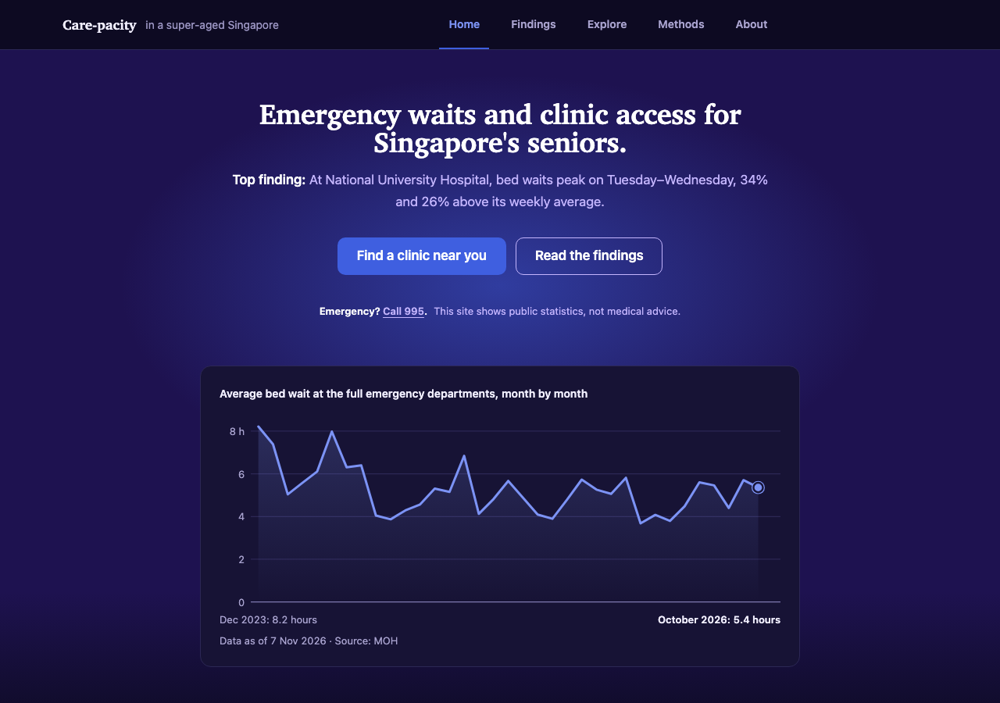
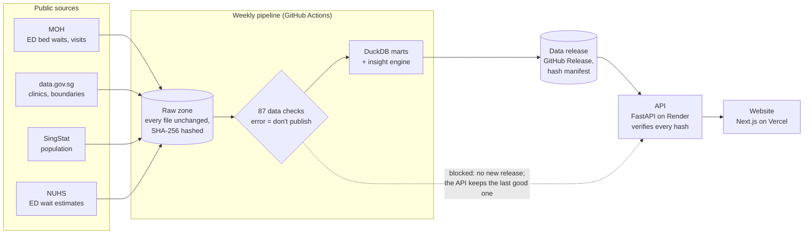

# Care-pacity: emergency waits and clinic access in a super-aged Singapore

**Where do Singapore's emergency departments wait longest for ward beds, and where do seniors have
the fewest chronic-care clinics? A tested, weekly-updated pipeline, API and website built from
public MOH, data.gov.sg and SingStat data. The site opens on the average bed wait month by month, then
two pictures, each with a one-line note: each hospital's latest bed wait against its own usual level,
and clinics per senior by planning area. A separate page finds the nearest polyclinics and GP clinics
for any postcode. Every figure comes from the latest weekly data release, with its date and source.**

**Live site: [sg-care-capacity-web.vercel.app](https://sg-care-capacity-web.vercel.app/)** ·
[Case study](https://sg-care-capacity-web.vercel.app/case-study) ·
[One-page summary](https://sg-care-capacity-web.vercel.app/summary) ·
[Independent audit](docs/audit_report.md)

[](https://sg-care-capacity-web.vercel.app/)

<p align="center">
  
  
</p>

<sub>Screenshots from data release `data-2026-11-17`. Light and dark follow the device setting.</sub>

## The site

| Page | What it is for |
|---|---|
| **Home** `/` | The claim, two buttons and the 995 line; the average bed wait month by month with three headline figures (when the data release has monthly figures); then two pictures with a short note each. **Bed waits against each hospital's usual**: one hour scale for every hospital, the latest week in royal blue, a status pill (▼ lower, ▬ about usual, ▲ higher, ▲▲ much higher), and a short note when a big move stays inside the hospital's own range of the 8 weeks before. **Clinics per 1,000 residents aged 65+** by planning area (plain SVG, no map script): a legend whose ranges meet with no gap, and why each unranked area isn't ranked. Each picture has its date and source, a table and CSV/Excel downloads. A "Data and privacy" panel repeats the footer's promise and links to the methods and data quality |
| **Find a clinic** `/find` | A postcode search for the nearest polyclinics, CHAS GP clinics and emergency departments. The search runs in the browser and is never sent to a server. Then the nearest emergency departments, a map of every hospital against its usual, and how the figures are made |
| **Findings** | What the latest data release shows, each finding computed by code and shown with how sure it is |
| **Explore** | ED trends, the Access Map (3D, 2D and table) and the NUHS live estimates |
| **Methods, About** | Where each number comes from and what it can't tell you; the case study and the decisions behind the build |

### Design

- **Colour.** Purple, electric violet and royal blue, each with one job: royal blue for the main action, the active tab and key
  data marks; violet for links, focus rings and highlights; deep purple for the hero and, in light mode, headings. Status
  colours never use a brand hue (teal lower, grey about usual, amber higher, crimson much higher), and a status is always a
  mark and a word as well as a colour. The access maps use one lavender-to-deep-royal ramp in even steps.
- **Checked, not eyeballed.** Every colour is a token in [`web/styles/tokens.css`](web/styles/tokens.css). Tests check text
  at 4.5:1 and graphics at 3:1 on every surface in both themes, and that status, brand and chart colours stay apart under
  protanopia, deuteranopia and tritanopia simulation.
- **Type.** Headings in a serif (Charter on Apple devices, Cambria on Windows), text in the device's own interface font. No
  web font is downloaded, so text never shifts as it loads.
- **Light and dark** follow the device setting; there is no theme switch. Print is always light.
- **No alarm.** There is no red banner: the 995 emergency number and "not medical advice" share one small line on the home
  page's first screen, and the 995 number is in the footer of every page.
- **Plain words.** Abbreviations are spelled out on first use on each page (never twice), with a definition on hover or tap.
  Links underline only their own words.

## What the data shows

From the [case study](docs/case_study.md), weekly data release `data-2026-11-08`:

1. **ED demand is high and steady.** The 8 sites MOH reported throughout (7 emergency departments
   and Alexandra Hospital's urgent care centre) recorded 868,644 visits in 2023, 863,988 in 2024
   and 869,131 in 2025.
2. **Waits for a ward bed vary widely by hospital.** In 2025, the typical wait after the decision
   to admit ranged from **2.5 hours** (KTPH, NTFGH) to **6.2 hours** (CGH).
3. **Community care is uneven.** Across the 32 planning areas with at least 1,000 residents aged
   65+, CDMP GP clinics per 1,000 seniors range from **0** (River Valley, Tengah) to **5.02**
   (Rochor), with a median of 1.16.

Context: 19.5% of residents were aged 65 or over in June 2026. The site also says what the data
can't show: how many ED visits are by older residents, or whether clinic access affects ED use.

## How it works



Each Sunday the pipeline downloads the sources, checks them and publishes a new data release.
Publishing restarts the API, which serves only that release, read-only. The website shows every
number with its "Data as of" date and source.

## How accuracy is ensured

- **Raw zone.** Every downloaded file is kept unchanged, with its SHA-256 hash. Every table can be
  rebuilt offline from these files, and every row records the file it came from.
- **Data checks that can stop a release.** 87 checks ran on the latest release: units, ranges,
  completeness, freshness and reconciliation between sources. A failing error-level check blocks
  publishing, and the site keeps serving the last good release. Bad rows are set aside, never
  corrected.
- **Nothing filled in.** Missing values stay missing: a gap in a chart, an empty cell in a CSV.
- **Findings are computed, not written.** Each finding is produced by fixed code from the data and
  published only if it passes a statistical test, corrected for the number of tests run. Findings
  never use causal words.
- **Independent audit.** An agent that never saw the code traced 20 random numbers on the site back
  to the exact raw cells: 19 matched; the 20th is an external citation. It rebuilt two tables from
  scratch, which matched. It found 1 critical, 1 high and 5 medium issues. All are fixed, each with
  a test ([audit report](docs/audit_report.md)).
- **Tests on every push.** Over 2,500 automated tests run in CI: about 1,200 website unit tests, about
  850 browser checks, about 380 pipeline tests and about 140 API tests. Another 100 acceptance checks run
  on the real built data (`make test`). The browser checks cover every page at 1280 and 375 px wide (with
  overflow checks at 768 and 1440 px), WCAG 2.1 AA accessibility with axe on every page (2.2 AA as well on
  the home page and the newer pages) in light and dark, and Lighthouse budgets for loading time and layout
  shift.

## Tech stack

| Part | Built with |
|---|---|
| Pipeline | Python 3.12, DuckDB, pandas, geopandas/shapely |
| API | FastAPI, served from a verified, read-only data release |
| Website | Next.js (App Router), TypeScript, Tailwind with design tokens (CSS variables) for every colour, size and space; server-rendered SVG charts and a server-rendered area map on the home page; Leaflet (2D) and three.js (3D) maps on the finder and the Access Map |
| Hosting and automation | GitHub Actions (weekly pipeline, CI), GitHub Releases (data), Render (API), Vercel (website) |
| Testing | pytest, Vitest, Playwright with axe, Lighthouse CI |

Only aggregate public data is used. There is no personal or patient-level data.

The API runs on Render's free plan, which sleeps after about 15 idle minutes and takes 30 to 60 seconds to wake. The website
keeps each API response for an hour and refreshes it in the background, so most visits never wait; the first visit after a
long quiet spell can.

## Run it locally

You need Python 3.12 and Node.js 24. The API downloads and verifies the latest published data
release itself, so you don't need to run the pipeline first.

```bash
# 1. The API (terminal 1)
python3.12 -m venv .venv && source .venv/bin/activate
pip install -e "api[dev]"
uvicorn --factory sg_health_api.main:create_app --port 8000      # http://127.0.0.1:8000/docs

# 2. The website (terminal 2)
cd web && npm ci && cp .env.example .env.local
npm run dev                                                       # http://localhost:3000
```

To build the data yourself, then run every test:

```bash
pip install -e "pipeline[dev]"
sg-health run && sg-health publish --out data/build/publish      # download, check, build, publish
LOCAL_SNAPSHOT_PATH=data/build/publish uvicorn --factory sg_health_api.main:create_app --port 8000
make test                                                         # pipeline, API, web and acceptance tests
```

## Documentation

| Read this | For |
|---|---|
| [Case study](docs/case_study.md) | The problem, stakeholders, personas, patient flow, priorities and success metrics |
| [Methodology](docs/methodology.md) | Sources, measures, the map method and what the data can't tell you |
| [Data dictionary](docs/data_dictionary.md) | Every column: definition, unit, source and caveats |
| [Data quality](docs/data_quality.md) | Every check, its threshold and why |
| [Audit report](docs/audit_report.md) | The independent audit and how each finding was resolved |
| [Decisions](docs/adr/) | Architecture decision records |
| [Redesign brief](docs/design/redesign_brief.md) and [review](docs/design/review_2026-11-16.md) | The "calm & clear" redesign: principles, measurements before and after, and what is still open |
| [Design tokens](web/styles/tokens.css) | Every colour, with its role, for light, dark and print; the type scale and spacing |
| [Pipeline guide](docs/pipeline.md) | Installing and running the pipeline, the raw zone and the history backfill |
| [Runbook](docs/runbook.md) | Deploying, rolling back a data release, rotating keys, failed runs |
