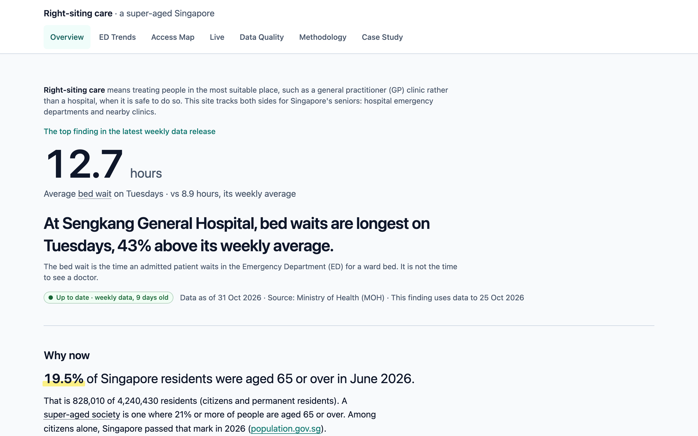
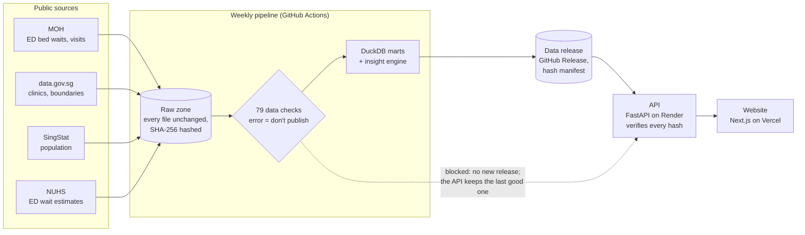

# Right-siting care in a super-aged Singapore

**Where do Singapore's emergency departments wait longest for ward beds, and where do seniors have
the fewest chronic-care clinics? A tested, weekly-updated pipeline, API and website built from
public MOH, data.gov.sg and SingStat data.**

**Live site: [sg-care-capacity-web.vercel.app](https://sg-care-capacity-web.vercel.app/)** ·
[Case study](https://sg-care-capacity-web.vercel.app/case-study) ·
[One-page summary](https://sg-care-capacity-web.vercel.app/summary) ·
[Independent audit](docs/audit_report.md)

[](https://sg-care-capacity-web.vercel.app/)

## What the data shows

From the [case study](docs/case_study.md), weekly data release `data-2026-11-08`:

1. **ED demand is high and steady.** The 8 sites MOH reported throughout (7 emergency departments
   and Alexandra Hospital's urgent care centre) recorded 868,644 visits in 2023, 863,988 in 2024
   and 869,131 in 2025.
2. **Waits for a ward bed vary widely by hospital.** In 2025, the typical wait after the decision
   to admit ranged from **2.5 hours** (KTPH, NTFGH) to **6.2 hours** (CGH).
3. **Community care is uneven.** Across the 32 planning areas with at least 1,000 residents aged
   65+, CDMP GP clinics per 1,000 seniors range from **0** (River Valley, Tengah) to **5.02**
   (Rochor), with a median of 1.16.

Context: 19.5% of residents were aged 65 or over in June 2026. The site also says what the data
can't show: how many ED visits are by older residents, or whether clinic access affects ED use.

## How it works



Each Sunday the pipeline downloads the sources, checks them and publishes a new data release.
Publishing restarts the API, which serves only that release, read-only. The website shows every
number with its "Data as of" date and source.

## How accuracy is ensured

- **Raw zone.** Every downloaded file is kept unchanged, with its SHA-256 hash. Every table can be
  rebuilt offline from these files, and every row records the file it came from.
- **Data checks that can stop a release.** 79 checks ran on the latest release: units, ranges,
  completeness, freshness and reconciliation between sources. A failing error-level check blocks
  publishing, and the site keeps serving the last good release. Bad rows are set aside, never
  corrected.
- **Nothing filled in.** Missing values stay missing: a gap in a chart, an empty cell in a CSV.
- **Findings are computed, not written.** Each finding is produced by fixed code from the data and
  published only if it passes a statistical test, corrected for the number of tests run. Findings
  never use causal words.
- **Independent audit.** An agent that never saw the code traced 20 random numbers on the site back
  to the exact raw cells: 19 matched; the 20th is an external citation. It rebuilt two tables from
  scratch, which matched. It found 1 critical, 1 high and 5 medium issues. All are fixed, each with
  a test ([audit report](docs/audit_report.md)).
- **Tests on every push.** Over 1,000 automated tests run in CI. They cover the pipeline, the API's
  contract, the website, and end-to-end checks of every page at 1280 and 375 px wide, including
  WCAG 2.1 AA accessibility and Lighthouse performance budgets.

## Tech stack

| Part | Built with |
|---|---|
| Pipeline | Python 3.12, DuckDB, pandas, geopandas/shapely |
| API | FastAPI, served from a verified, read-only data release |
| Website | Next.js (App Router), TypeScript, Tailwind; server-rendered SVG charts; Leaflet (2D) and three.js (3D) maps |
| Hosting and automation | GitHub Actions (weekly pipeline, CI), GitHub Releases (data), Render (API), Vercel (website) |
| Testing | pytest, Vitest, Playwright with axe, Lighthouse CI |

Only aggregate public data is used. There is no personal or patient-level data.

## Run it locally

You need Python 3.12 and Node.js 24. The API downloads and verifies the latest published data
release itself, so you don't need to run the pipeline first.

```bash
# 1. The API (terminal 1)
python3.12 -m venv .venv && source .venv/bin/activate
pip install -e "api[dev]"
uvicorn --factory sg_health_api.main:create_app --port 8000      # http://127.0.0.1:8000/docs

# 2. The website (terminal 2)
cd web && npm ci && cp .env.example .env.local
npm run dev                                                       # http://localhost:3000
```

To build the data yourself, then run every test:

```bash
pip install -e "pipeline[dev]"
sg-health run && sg-health publish --out data/build/publish      # download, check, build, publish
LOCAL_SNAPSHOT_PATH=data/build/publish uvicorn --factory sg_health_api.main:create_app --port 8000
make test                                                         # pipeline, API, web and acceptance tests
```

## Documentation

| Read this | For |
|---|---|
| [Case study](docs/case_study.md) | The problem, stakeholders, personas, patient flow, priorities and success metrics |
| [Methodology](docs/methodology.md) | Sources, measures, the map method and what the data can't tell you |
| [Data dictionary](docs/data_dictionary.md) | Every column: definition, unit, source and caveats |
| [Data quality](docs/data_quality.md) | Every check, its threshold and why |
| [Audit report](docs/audit_report.md) | The independent audit and how each finding was resolved |
| [Decisions](docs/adr/) | Architecture decision records |
| [Pipeline guide](docs/pipeline.md) | Installing and running the pipeline, the raw zone and the history backfill |
| [Runbook](docs/runbook.md) | Deploying, rolling back a data release, rotating keys, failed runs |
