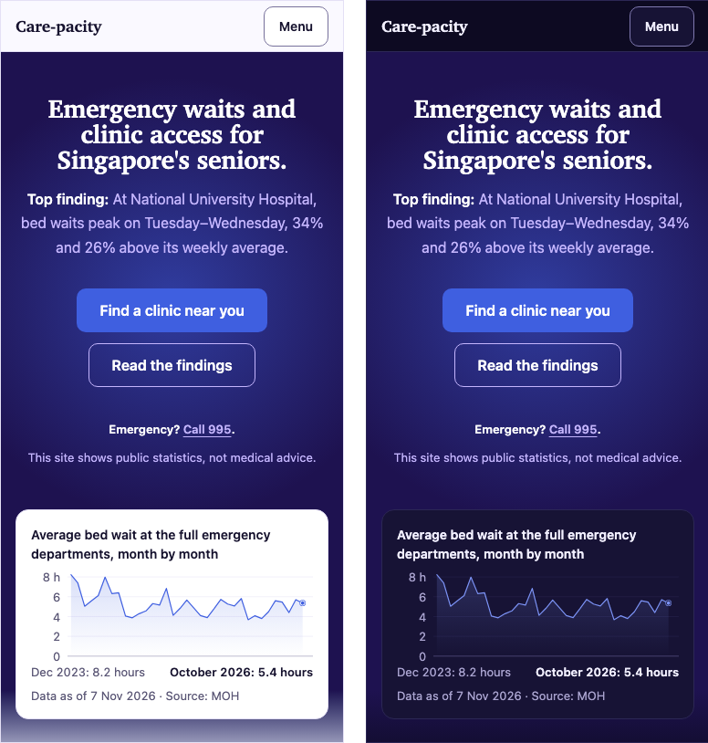
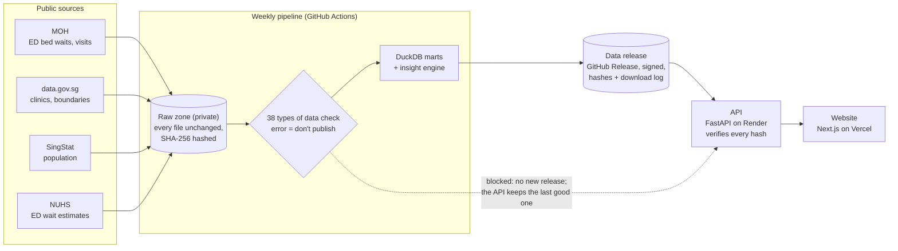

# Care-pacity: hospital bed waits and clinic access in a super-aged Singapore

**Which public hospitals take longest to find admitted patients a ward bed, and where do seniors have
the fewest chronic-care GP clinics? A tested pipeline, API and website built from
public MOH, data.gov.sg and SingStat data. The two are separate sets of figures shown side by side: the bed-wait
data has no age breakdown and does not cover time to see a doctor, and this project does not test a link between the two.
The pipeline checks the sources every Sunday and publishes a release when MOH has new figures; MOH's figures end 6 to 11 days before each release. The site opens on the latest release's top finding and the
average bed wait month by month, then two pictures, each with a one-line note: each hospital's latest bed wait against its own usual level,
and clinics per senior by planning area. A separate page finds the nearest polyclinics and GP clinics
for any postcode. Every figure comes from the latest data release, with its date and source.**

**Live site: [sg-care-capacity-web.vercel.app](https://sg-care-capacity-web.vercel.app/)** ·
[Case study](https://sg-care-capacity-web.vercel.app/case-study) ·
[One-page summary](https://sg-care-capacity-web.vercel.app/summary) ·
[AI-assisted traceability audit](docs/audit_report.md)

[![The home page in light mode: on a deep-purple hero with a royal-blue glow, the heading "Hospital bed waits in Singapore, and clinic access for seniors", the top finding (across all hospitals, bed waits are longest on Tuesdays, 37% above each hospital's weekly average), two buttons, the 995 line, a line saying the bed-wait and clinic figures are shown side by side with no link tested, then a card with the average bed wait at the 7 full emergency departments month by month, from December 2023 (8.2 hours) to October 2026 (5.4 hours)](docs/images/home.png)](https://sg-care-capacity-web.vercel.app/)

<p align="center">
  
  
</p>

<sub>Screenshots from data release `data-2026-11-25`, made with `web/scripts/readme-screenshots.mjs`. Light and dark follow the device setting.</sub>

## The site

| Page | What it is for |
|---|---|
| **Home** `/` | The claim; the release's top finding, word for word from the insight engine; two buttons and the 995 line; the average bed wait month by month, on an hour scale with its first and latest values, and in the same card the latest month's emergency department visits and its bed wait against a year before, in words as well as a sign (when the data release has monthly figures); then two pictures with a short note each. **Bed waits against each hospital's usual**: one hour scale for every hospital, the latest week in royal blue, a status pill (▼ lower, ▬ about usual, ▲ higher, ▲▲ much higher), and a short note when a big move stays inside the hospital's own week-to-week swing. **Clinics per 1,000 residents aged 65+** by planning area (plain SVG, no map script): a legend whose ranges meet with no gap, and why each unranked area isn't ranked. Each picture has its date and source, a table and CSV/Excel downloads. Then the three ways on. The data and privacy promise is in the footer of every page |
| **Find a clinic** `/find` | A postcode search for the nearest polyclinics, CHAS GP clinics and emergency departments. The search runs in the browser and is never sent to a server; until the page's script has loaded the button waits rather than reloading the page, and anything already typed is kept. A phone shows the nearest three places, with the rest one tap away. Then the nearest emergency departments, a map of every hospital against its usual, and how the figures are made |
| **Findings** | What the latest data release shows, each finding computed by code and shown with how sure it is, and every test run, including the ones that found nothing |
| **Explore** | ED trends (the hospital and date filters fold behind one line that says what is shown), with every week since 2023 marked as the status badge marks the latest, and how each hospital's days spread around its weekly figures; the Access Map (3D, 2D and table) and the NUHS live estimates |
| **Summary** `/summary` | One printable A4 page: the top findings, the priority areas (with how they are ranked) and the limits |
| **Hospital** `/hospital/[code]` | One hospital month by month and year on year, with exact values on hover; every week since MOH's data starts, with the trend test's 26 weeks shaded and its result in words; and, where a link was published, the days its visits-and-waits test ran on. An unknown code lists the real hospitals |
| **Methods, About** | Where each number comes from and what it can't tell you; who built it, the project in 60 seconds (with a live chart and every data check counted), and the case study |

### Design

- **Colour.** Purple, electric violet and royal blue, each with one job: royal blue for the main action, the active tab and key
  data marks; violet for links, focus rings and highlights; deep purple for the hero and, in light mode, headings. Status
  colours never use a brand hue (teal lower, grey about usual, amber higher, crimson much higher), and a status is always a
  mark and a word as well as a colour. The access maps use one lavender-to-deep-royal ramp in even steps.
- **Colour checks.** Every colour is a token in [`web/styles/tokens.css`](web/styles/tokens.css). Tests check text
  at 4.5:1 and graphics at 3:1 on every surface in both themes, and that status, brand and chart colours stay apart under
  protanopia, deuteranopia and tritanopia simulation.
- **Type.** Headings in a serif (Charter on Apple devices, Cambria on Windows), text in the device's own interface font. No
  web font is downloaded, so text never shifts as it loads.
- **Charts.** Every chart starts its value axis at 0 and labels it with round ticks. Under each chart, one line gives the date
  and source, and one row holds the freshness badge, "More about these figures" (caveats and notes) and the downloads.
  Status colours follow one rule: a worse result is amber, and crimson is kept for "much higher".
- **Diagrams.** The case study's stakeholder grid and patient flows are drawn as server-rendered SVG in the site's colours.
  GitHub shows the Mermaid source of the same diagrams; no diagram script is sent to the browser.
- **Light and dark** follow the device setting; there is no theme switch. Print is always light.
- **The 995 line.** There is no red banner: the 995 emergency number and "not medical advice" share one small line on the home
  page's first screen, and the 995 number is in the footer of every page.
- **Plain words.** Abbreviations are spelled out on first use on each page (never twice), with a definition on hover or tap.
  Links underline only their own words.

## What the data shows

From the [case study](docs/case_study.md). Each figure was checked again against data release
`data-2026-11-17` on 20 Nov 2026 and against `data-2026-11-25` on 25 Nov 2026, and is unchanged:

1. **ED demand is high and steady.** The 8 sites MOH reported throughout (7 emergency departments
   and Alexandra Hospital's urgent care centre) recorded 868,644 visits in 2023, 863,988 in 2024
   and 869,131 in 2025.
2. **Waits for a ward bed vary widely by hospital.** In 2025, the typical wait after the decision
   to admit ranged from **2.5 hours** (KTPH, NTFGH) to **6.2 hours** (CGH).
3. **Community care is uneven.** Across the 32 planning areas with at least 1,000 residents aged
   65+, CDMP GP clinics per 1,000 seniors range from **0** (River Valley, Tengah) to **5.02**
   (Rochor), with a median of 1.16.

Context: 19.5% of residents were aged 65 or over in June 2026. The site also says what the data
can't show: how many ED visits are by older residents, or whether clinic access affects ED use.

## How it works



Each Sunday the pipeline downloads the sources, checks them and publishes a new data release.
Publishing restarts the API, which serves only that release, read-only. The website shows every
number with its "Data as of" date and source.

## How accuracy is ensured

- **Raw zone.** Every downloaded file is kept unchanged, with its SHA-256 hash. Every table can be
  rebuilt offline from these files, and every row records the file it came from. The files are kept
  in a private repository, because some sources' terms don't allow re-publishing them.
- **Checkable by anyone.** Each data release lists every download (URL, SHA-256, time) in
  `fetch_log.json`, so a reader can fetch the same file from MOH or data.gov.sg and compare. The
  Wayback Machine keeps its own dated copy of each MOH and NUHS file, and every release file is signed
  by the workflow that built it (`gh attestation verify`). Steps:
  [Verify a figure](docs/methodology.md#verify-a-figure).
- **Data checks that can stop a release.** 38 types of data check cover units, ranges,
  completeness, freshness and reconciliation between sources; each is documented, with its threshold,
  in [data_quality.md](docs/data_quality.md). Most types run once for every table they apply to, and
  findings the insight engine skips are logged too, so the number of checks run varies by release.
  The live [Data Quality page](https://sg-care-capacity-web.vercel.app/data-quality) shows the latest run. A failing
  error-level check blocks publishing, and the site keeps serving the last good release. Bad rows
  are set aside, never corrected.
- **Nothing filled in.** Missing values stay missing: a gap in a chart, an empty cell in a CSV.
- **Findings are computed, not written.** Each finding is produced by fixed code from the data and
  published only if it passes a statistical test, corrected for the number of tests run. Findings
  never use causal words.
- **AI-assisted traceability audit, run by the author.** An AI agent that was not given the code traced 20 random numbers on the site back
  to the exact raw cells: 19 matched; the 20th is an external citation. It rebuilt two tables from
  scratch, which matched. It found 1 critical, 1 high and 5 medium issues. All are fixed, each with
  a test ([audit report](docs/audit_report.md)). Limits: a sample of 20 numbers, set up and run by the project's author, with no
  human reviewer. It is a traceability check, not an independent third-party audit.
- **Recomputed from the data release.** On 20 Nov 2026 the published release `data-2026-11-17` was checked by an AI agent
  (set up by the author) with separate code that shares nothing with the pipeline. Weekly and monthly averages, totals, completeness flags and
  year-on-year changes matched in every row. So did the all-hospital monthly series, the clinics per 1,000 seniors in every
  area, and the three headline findings: the weekday test, the visits and bed-wait correlation, and the priority ranking.
  The live API served the same values.
- **Tests on every push.** Over 2,500 automated tests (counted on 27 Nov 2026): about 1,200 website unit
  tests, about 690 browser checks, about 400 pipeline tests and about 150 API tests run in CI, and about
  110 acceptance checks run on the real built data (`make test`). The browser checks cover every page at 1280 and 375 px wide (with
  overflow checks at 768 and 1440 px), WCAG 2.1 AA accessibility with axe on every page (2.2 AA as well on
  the home page and the newer pages) in light and dark. Lighthouse checks the home, finder, findings and ED trends pages against budgets: largest paint
  within 2.5 s (target 2.0 s), layout shift under 0.01 and under 200 kB of JavaScript. It applies a slow 4G network and a
  4x slower CPU for real and measures the paint, which comes at about 1.5 s on each of these pages.

## How this was built: AI assistance

This project was built with an AI coding assistant (Claude Code; the working rules it follows are in [`CLAUDE.md`](CLAUDE.md)).
The assistant wrote most of the code, tests and documentation drafts. The checks described above (the data checks, the
recomputation and the traceability audit) were also run by AI agents, set up by the author. None of them is a human review.

What the author did, as the record of the work shows:

- **Set the question and the rules.** The author chose the topic, the audience, and the working rules in `CLAUDE.md`: no
  patient-level data, nothing filled in or guessed, a date and source on every figure, and no causal wording.
- **Decided between options.** The author approved or chose the plans: which claims to reword, to keep small clinic areas
  ranked but marked, to label (not add) polyclinics, and to treat the site as a public tool with portfolio material on About.
- **Commissioned the reviews and acted on them.** The author ran the traceability audit, a plain-language comprehension test and
  a UX critique, and had each finding fixed with a test.
- **Pushed back on the site's own claims.** A pre-publish critique led to rewording "emergency waits" and "seniors", renaming
  the audit, and changing the "usual" rule, which flagged a hospital in 13% of weeks.
- **Not done by the author:** writing the code line by line, or reading every figure against the source files. The AI agents did
  the checks described above, and no human has reviewed them.

## Limitations and what I would do next

- **No age split in the ED data.** MOH's bed-wait and visit figures do not say how old the patients are, so the site cannot say
  anything about seniors' emergency waits. The two halves of the site are shown side by side; no link between them is tested.
- **Bed waits, not total waits.** The figure is the wait for a ward bed after the decision to admit. It leaves out time to
  be seen, and patients who go home.
- **Noisy weekly figures.** A week is an average of seven daily medians. It understates busy days and the longest waits, and
  some hospitals swing widely week to week; the site marks a week only when it is far outside the hospital's own range.
- **CDMP GP clinics only.** The clinic ratio leaves out polyclinics, opening hours, doctors, cost and transport, and uses a
  clinic list that is about two years older than the resident counts.
- **Small areas.** A few planning areas have few seniors, so one clinic changes their rate a lot; they are marked, not hidden.
- **Next:** an age-specific ED source if one is ever published; polyclinics in the access measure; a human reviewer for the
  audit; MOH's own longest-wait figures if they become available.

## Data use and licences

An independent, non-commercial project, not affiliated with or endorsed by any agency. Only aggregate
public data is used; there is no personal or patient-level data. The data.gov.sg, MOH, SingStat and
OneMap data is used under the [Singapore Open Data Licence](https://data.gov.sg/open-data-licence),
with the notices in [Licences and attribution](docs/methodology.md#licences-and-attribution). NUHS's
page is read for its figures only and never re-published. The crawler names itself, keeps to
robots.txt and waits between requests.

## Tech stack

| Part | Built with |
|---|---|
| Pipeline | Python 3.12, DuckDB, pandas, geopandas/shapely |
| API | FastAPI, served from a verified, read-only data release |
| Website | Next.js (App Router), TypeScript, Tailwind with design tokens (CSS variables) for every colour, size and space; server-rendered SVG charts and a server-rendered area map on the home page; Leaflet (2D) and three.js (3D) maps on the finder and the Access Map |
| Hosting and automation | GitHub Actions (weekly pipeline, CI), GitHub Releases (data), Render (API), Vercel (website) |
| Testing | pytest, Vitest, Playwright with axe, Lighthouse CI |

Only aggregate public data is used. There is no personal or patient-level data.

The API runs on Render's free plan, which sleeps after about 15 idle minutes and takes 30 to 60 seconds to wake. The website
keeps each API response for an hour and refreshes it in the background, so most visits never wait; the first visit after a
long quiet spell can.

## Run it locally

You need Python 3.12 and Node.js 24. The API downloads and verifies the latest published data
release itself, so you don't need to run the pipeline first.

```bash
# 1. The API (terminal 1)
python3.12 -m venv .venv && source .venv/bin/activate
pip install -e "api[dev]"
uvicorn --factory sg_health_api.main:create_app --port 8000      # http://127.0.0.1:8000/docs

# 2. The website (terminal 2)
cd web && npm ci && cp .env.example .env.local
npm run dev                                                       # http://localhost:3000
```

To build the data yourself, then run every test:

```bash
pip install -e "pipeline[dev]"
sg-health run && sg-health publish --out data/build/publish      # download, check, build, publish
LOCAL_SNAPSHOT_PATH=data/build/publish uvicorn --factory sg_health_api.main:create_app --port 8000
make test                                                         # pipeline, API, web and acceptance tests
```

## Documentation

| Read this | For |
|---|---|
| [Case study](docs/case_study.md) | The problem, stakeholders, personas, patient flow, priorities and success metrics |
| [Methodology](docs/methodology.md) | Sources, measures, the map method and what the data can't tell you |
| [Data dictionary](docs/data_dictionary.md) | Every column: definition, unit, source and caveats |
| [Data quality](docs/data_quality.md) | Every check, its threshold and why |
| [Audit report](docs/audit_report.md) | The AI-assisted traceability audit and how each finding was resolved |
| [Decisions](docs/adr/) | Architecture decision records |
| [Redesign brief](docs/design/redesign_brief.md) and [review](docs/design/review_2026-11-16.md) | The "calm & clear" redesign: principles, measurements before and after, and what is still open |
| [Design tokens](web/styles/tokens.css) | Every colour, with its role, for light, dark and print; the type scale and spacing |
| [Pipeline guide](docs/pipeline.md) | Installing and running the pipeline, the raw zone and the history backfill |
| [Runbook](docs/runbook.md) | Deploying, rolling back a data release, rotating keys, failed runs |

## Licence

The code and documentation are [MIT-licensed](LICENSE). The data stays under its publishers' terms.
