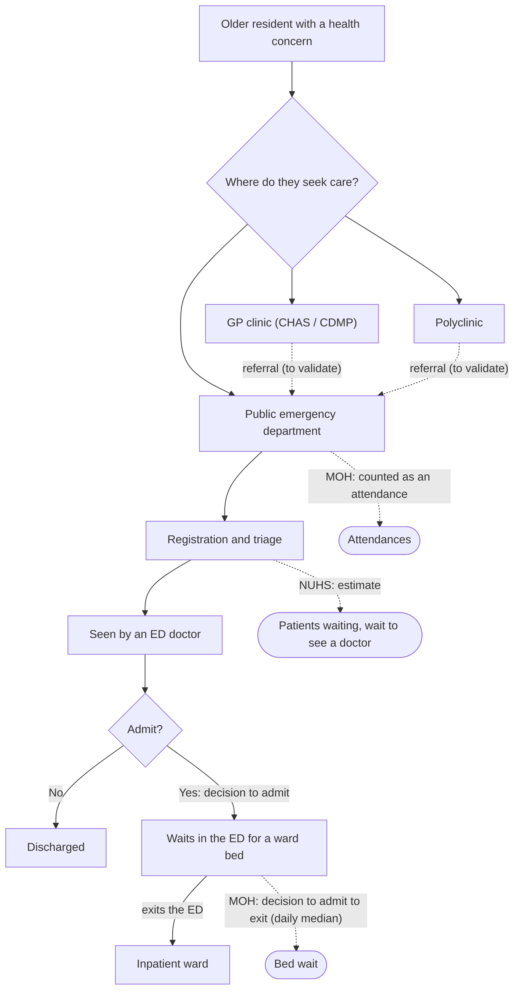
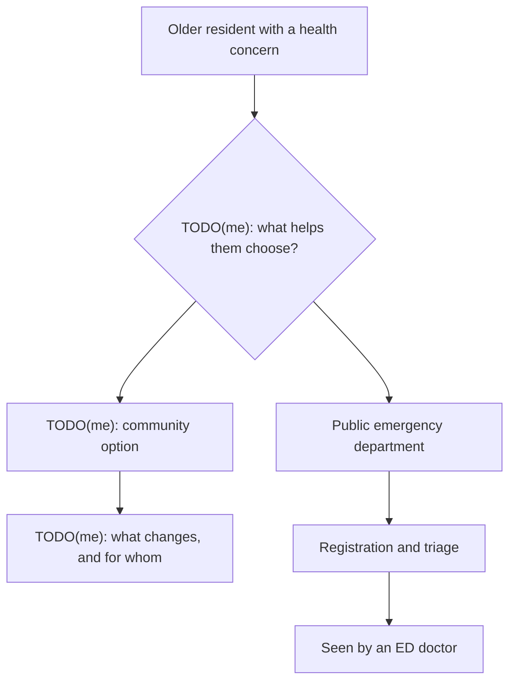

# Case study: right-siting care in a super-aged Singapore

**Draft.** Paragraphs starting with **TODO(me)** need the author's own judgement, research or
interviews. Everything else follows from the published data and the project's docs. No quotes,
interview findings or outcomes are invented. Figures are from snapshot `data-2026-11-06` unless
stated otherwise.

## Problem statement

**What the data shows:**

- **An ageing population.** 828,010 of Singapore's 4,240,430 residents, **19.5%**, were aged 65 or
  over in June 2026 (SingStat).
- **ED demand at a high, steady level.** The 8 public EDs MOH reported throughout recorded 868,644
  attendances in 2023, 863,988 in 2024 and 869,131 in 2025 (MOH). All-site totals rise to 949,568
  in 2025 only because Woodlands Hospital joined the figures in June 2024.
- **Long waits for a ward bed, which vary by hospital.** In 2025, the typical daily median wait from
  the decision to admit to leaving the ED ranged from 2.5 hours (KTPH, NTFGH) to 6.2 hours (CGH) at
  the EDs, and 1.3 hours at Alexandra Hospital's urgent care centre (MOH; median of daily medians).
- **Uneven community capacity.** Among the 32 planning areas with at least 1,000 residents aged 65+,
  CDMP clinics per 1,000 seniors range from **0** (River Valley, Tengah) to **5.02** (Rochor), with a
  median of **1.16** (data.gov.sg CHAS list, June 2024; SingStat June 2026).

**What the data can't show** (see [methodology](methodology.md#what-this-data-cant-tell-you)):

- how many ED attendances are by older residents;
- how many could have been handled in primary care;
- whether clinic access affects ED use.

The project makes both sides of the question visible and trustworthy. It doesn't answer the
question.

TODO(me): The problem in your own words. Who has it, why it matters now, and what decision this
product is meant to support. Keep to what the evidence above can carry.

TODO(me): Your sources for the policy context (e.g. Healthier SG, right-siting), cited, if you use them.

## Stakeholder map

Each stakeholder's documented relationship to this data. Their interests, influence and needs have
not been researched yet.

| Stakeholder | Relationship to this data (documented) | Interests and needs | Influence / interest |
|---|---|---|---|
| **MOH** | Publishes the ED bed-wait and attendance statistics; runs the CHAS and CDMP schemes whose clinics are mapped | TODO(me) | TODO(me) |
| **Cluster operations** (SingHealth, NHG Health, NUHS) | Run the 9 public ED sites measured; NUHS publishes the ED wait estimates shown on the Live page | TODO(me) | TODO(me) |
| **ED clinicians** | Make the "decision to admit" that starts MOH's bed-wait measure | TODO(me) | TODO(me) |
| **GPs / Healthier SG clinics** | The CHAS and CDMP clinics counted on the Access Map (Healthier SG enrolment itself is not in this data) | TODO(me) | TODO(me) |
| **Seniors and caregivers** | The 828,010 residents aged 65+ the access measures are about | TODO(me) | TODO(me) |
| **Synapxe** | Singapore's national HealthTech agency | TODO(me) | TODO(me) |

TODO(me): Place each stakeholder on an influence / interest grid, and say what evidence each
placement rests on (desk research, conversations, assumptions to test).

## Personas

Two personas, to be written from research. The template below has no invented details.

### Persona 1

TODO(me): Choose who this is (e.g. from the stakeholder list) and why.

| | |
|---|---|
| Role and context | TODO(me) |
| Goals | TODO(me) |
| Frustrations | TODO(me) |
| Decisions they make that this data could inform | TODO(me) |
| What on this site serves them | TODO(me) |
| Evidence behind this persona | TODO(me) |

### Persona 2

TODO(me): Choose who this is and why.

| | |
|---|---|
| Role and context | TODO(me) |
| Goals | TODO(me) |
| Frustrations | TODO(me) |
| Decisions they make that this data could inform | TODO(me) |
| What on this site serves them | TODO(me) |
| Evidence behind this persona | TODO(me) |

## Patient flow: as-is and to-be

### As-is

**What the diagram is based on:**
- **The ED steps** follow MOH's and NUHS's published measures, and show where each measure is taken.
- **The steps before the ED** are a structure to validate, not research findings.

The same flow in text:

1. An older resident with a health concern chooses where to seek care: a GP clinic, a polyclinic, or
   a public ED. Clinics may refer to the ED.
2. At the ED: registration and triage. **MOH counts every arrival as an attendance.** NUHS publishes
   estimates of patients waiting and the wait to see a doctor.
3. An ED doctor sees the patient and decides whether to admit.
4. If admitted, the patient waits in the ED for a ward bed. **MOH's bed-wait measure runs from the
   decision to admit to leaving the ED.**
5. The patient goes to an inpatient ward, or is discharged.

TODO(me): Validate the steps before the ED (how seniors and caregivers actually decide where to go,
and how referrals work) and record what the validation was based on.

### To-be

TODO(me): The to-be flow is a design proposal and needs your own judgement. The skeleton below
marks the decision points to fill in; it proposes nothing yet.

TODO(me): The same flow in text, once designed.

## Prioritised requirements (MoSCoW)

**Must** and **Won't** follow from the project's own data principles (CLAUDE.md) and the brief.
Each built item names the test that would fail if it broke. **Should** and **Could** are
candidates from the documented limitations; their priority is a judgement.

| ID | Requirement | Priority | Source | Status |
|---|---|---|---|---|
| M1 | No personal or patient-level data, ever | Must | Data principles | Built: only aggregate sources are collected ([methodology](methodology.md#sources)) |
| M2 | Never fabricate or impute; missing is shown as missing | Must | Data principles | Built: gaps in charts and "No data" on the map (`DailyWaitChart.test.tsx`, `quantiles.test.ts`, `test_geo.py`) |
| M3 | Every metric has a definition, unit, source and caveats | Must | Data principles | Built: `data_dictionary.md`, checked against the marts (`test_transform.py`) |
| M4 | Every number shows its `as_of` and source | Must | Data principles | Built: required by the API contract and the site's components ([ADR 0005](adr/0005-typed-api-contract.md)); checked on every page (`web/e2e`) |
| M5 | Failed error-level checks block publishing; the site keeps the last good snapshot | Must | Data principles | Built ([ADR 0002](adr/0002-validation-gate.md), `test_publish.py`) |
| M6 | Every row keeps its lineage | Must | Data principles | Built (`test_lineage.py`) |
| M7 | WCAG 2.1 AA; usable from 375 px wide | Must | Web brief | Built: axe checks and no sideways scrolling on every page (`web/e2e`) |
| S1 | Access measured as travel time, not straight-line distance | TODO(me) | [Methodology limitations](methodology.md#limitations) | Not built |
| S2 | NUHS estimates refreshed more often than weekly | TODO(me) | Live page caveat | Partly: collected every 3 hours into a separate store, not published |
| S3 | Access by subzone, not just planning area | TODO(me) | [Methodology choices](methodology.md#choices-made-deliberately) | Blocked: no Master Plan 2025 subzone boundaries are published |
| S4 | TODO(me): requirements from stakeholder research | TODO(me) | TODO(me) | |
| W1 | ED attendances by age or triage category | Won't | Not published by MOH | Not possible with public data |
| W2 | A heatmap of where residents live | Won't | [ADR 0004](adr/0004-choropleth-not-heatmap.md) | Would invent locations |

## Success metrics

### Product and data health (measurable now)

| Metric | Definition | Current value | Target |
|---|---|---|---|
| Publication lag | Days between MOH's latest report date and the snapshot | 6 days (31 Oct → 6 Nov 2026) | TODO(me) |
| Blocking checks | Failed checks that block publishing, in the published snapshot | 0 of 69 checks | TODO(me) |
| ED coverage | Days with both MOH figures, out of the days each site is reported | 100% for all 9 sites | TODO(me) |
| Provenance | Figures on the site showing their `as_of` and source | All (enforced by tests) | TODO(me) |

### Outcomes

TODO(me): What would show this product is useful (who uses it, for which decisions), and how you
would measure that. No outcomes have been measured; none are claimed here.

## Decision log

| # | Decision | Status |
|---|---|---|
| [0001](adr/0001-published-snapshot.md) | Publish a verified, read-only snapshot as a GitHub Release, not a shared DuckDB file | Accepted |
| [0002](adr/0002-validation-gate.md) | A validation gate: errors block publishing or quarantine rows; warnings are published and flagged | Accepted |
| [0003](adr/0003-svy21-for-distances-and-areas.md) | Compute every distance and area in SVY21 | Accepted |
| [0004](adr/0004-choropleth-not-heatmap.md) | Choropleth with clinic points, not a heatmap | Accepted |
| [0005](adr/0005-typed-api-contract.md) | One typed API contract, from Python models to TypeScript, checked in CI | Accepted |

## Limitations and next steps

**Limitations** (detail in [methodology](methodology.md#what-this-data-cant-tell-you)):

- **No link between the two halves.** The data can't connect clinic access to ED use; the site shows
  both sides, not a relationship between them.
- **ED figures say nothing about age or urgency.** So they can't show how much ED demand is from
  older residents, or how much could be seen elsewhere.
- **Access is measured roughly.** Distances are straight-line, figures are per planning area, and
  the clinic list is from June 2024. These describe areas, not people.
- **The NUHS readings are moments,** from the weekly snapshot, not a live feed.

**Next steps:**

- Candidates from the documented limitations: travel-time access (S1), more frequent NUHS
  estimates (S2), and subzone access once boundaries are published (S3).
- TODO(me): Which of these, if any, you would prioritise and why.
- TODO(me): What you would do differently with this project, and what you learned.
