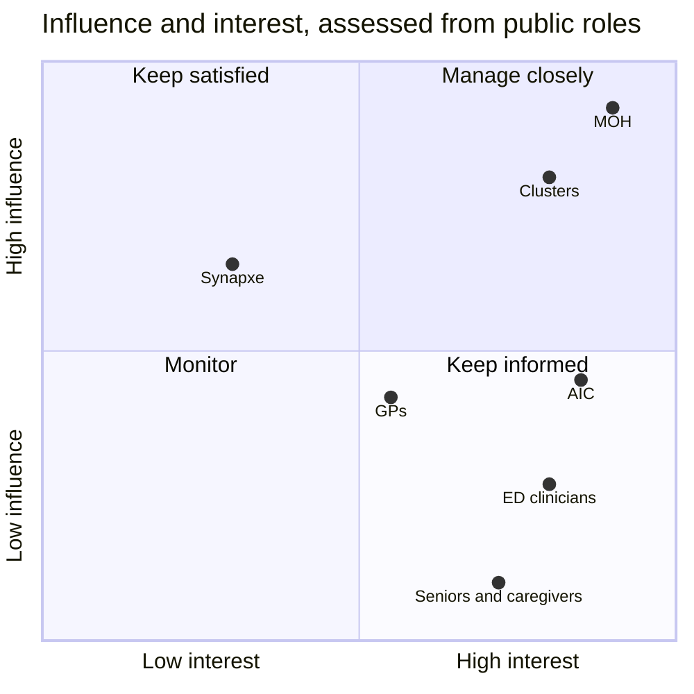
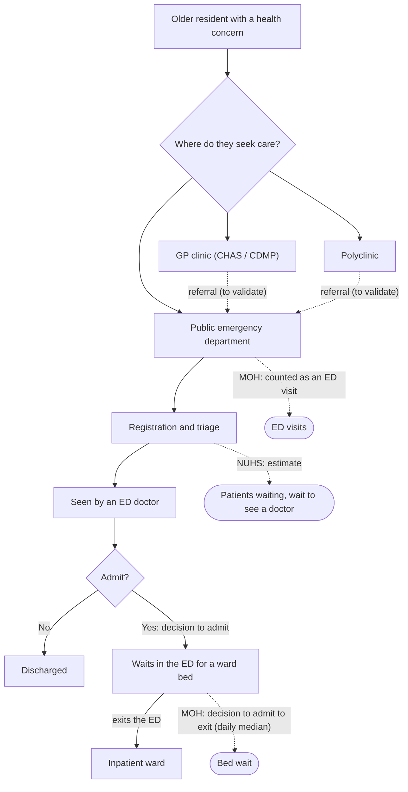
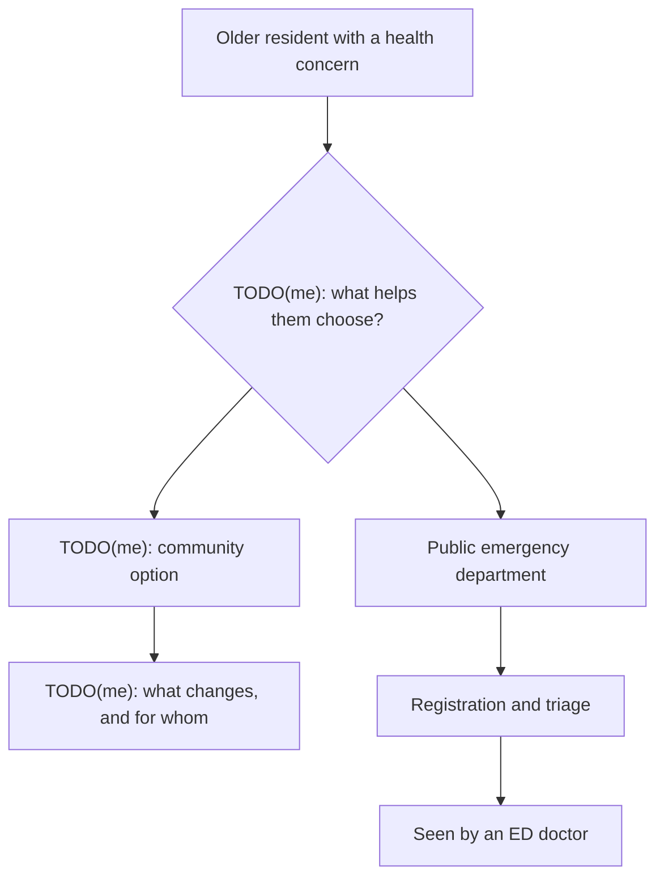

# Case study: right-siting care in a super-aged Singapore

**Draft.** Paragraphs starting with **TODO(me)** need the author's own judgement, research or
interviews. Everything else follows from the published data and the project's docs. No quotes,
interview findings or outcomes are invented. Figures are from weekly data release `data-2026-11-06`
unless stated otherwise.

## Problem statement

**What the data shows:**

- **A super-aged society.** 21.4% of Singapore citizens were aged 65 or over in June 2026, above the
  21% that defines a super-aged society
  ([population.gov.sg](https://www.population.gov.sg/our-population/population-trends/longevity/)).
  Counting all residents, including permanent residents, the share is **19.5%**: 828,010 of 4,240,430
  (SingStat). This site uses the residents' figure: it is the one published by area.
- **ED demand at a high, steady level.** The 8 public EDs MOH reported throughout recorded 868,644
  ED visits in 2023, 863,988 in 2024 and 869,131 in 2025 (MOH). The all-site total of 949,568 in
  2025 includes Woodlands Hospital, which MOH added to the figures in June 2024.
- **Long waits for a ward bed, which vary by hospital.** In 2025, the typical time waiting for a ward
  bed after the decision to admit ranged from 2.5 hours (KTPH, NTFGH) to 6.2 hours (CGH). It was
  1.3 hours at Alexandra Hospital's UCC. "Typical" is the middle value of each hospital's daily
  medians for the year (MOH).
- **Uneven community capacity.** This covers the 32 areas (URA planning areas) with at least 1,000
  residents aged 65+. CDMP GP clinics per 1,000 seniors range from **0** (River Valley, Tengah) to
  **5.02** (Rochor). The median is **1.16** (data.gov.sg CHAS list, June 2024; SingStat, June 2026).

**What the data can't show** (see [methodology](methodology.md#what-this-data-cant-tell-you)):

- how many ED visits are by older residents;
- how many could have been handled in primary care;
- whether clinic access affects ED use.

The project makes both sides of the question visible and trustworthy. It doesn't answer the
question.

**The problem.** Long waits for a ward bed in public emergency departments are a known pressure
point, and Singapore's population is ageing quickly. Planners need a consistent, checked view of
both. Where and when do bed waits run long? Where do seniors have the least access to chronic-care
clinics? Today the figures sit in separate MOH, data.gov.sg and SingStat releases,
each with its own format and date.

**Who it is for.** Planners at MOH and the Agency for Integrated Care (AIC). The site supplies the
analysis; the planners decide what to look into and what to do.

*Assumption, to validate:* no planners have been interviewed. Their needs are inferred from MOH's
published statements and from the public data.

**What it supports:**

- **Monitoring:** bed waits by hospital, day and week, each compared with the hospital's own usual
  level.
- **Prioritisation:** findings that pass a statistical test, ranked; and the areas with the most
  seniors per chronic-care clinic.
- **Checking:** every figure carries its source and date, and the data checks behind each weekly
  release are published.

**Why now:**

- **Singapore became a super-aged society in 2026.** 21.4% of citizens are 65 or over, above the 21%
  threshold ([population.gov.sg](https://www.population.gov.sg/our-population/population-trends/longevity/);
  [NTU, 26 Sep 2026](https://www.ntu.edu.sg/sss/news-events/news/detail/singapore-is-now-a-super-aged-society)).
- **ED bed waits are a recognised pressure point.** In November 2022, MOH told Parliament that the
  median wait for a ward bed averaged about seven hours. About 40% of ED attendances were non-urgent
  ([MOH, 8 Nov 2022](https://www.moh.gov.sg/news-highlights/details/bed-capacity-and-emergency-departments)).
- **Primary care is part of MOH's response.** Its measures included strengthening primary care and
  diverting less serious cases to nearby clinics. That shift of suitable care to the community is
  the "right-siting" this project looks at from both sides.

**Scope.** A monitoring tool and prioritisation aid, simple to use, and a possible proof of concept
for a larger planning tool. It does not forecast, and it does not recommend actions.

## Stakeholder map

Each stakeholder's role comes from official sources (listed below the grid). Their interests,
influence and interest are an **assessment from those public roles, not validated with the
stakeholders**: no one has been interviewed.

| Stakeholder | Role and relationship to this data (documented) | Interests and needs (assumed) | Influence / interest |
|---|---|---|---|
| **MOH** | Publishes the ED bed-wait and ED visit statistics; runs the CHAS and CDMP schemes whose clinics are mapped; sets Healthier SG policy | A system-wide view of ED pressure, and of the shift of suitable care to family doctors, from figures it can trace | High / High: manage closely |
| **Agency for Integrated Care (AIC)** | MOH Holdings' "National Care Integrator", the single agency coordinating aged care services | Where seniors may lack nearby chronic-care clinics, to plan community care and outreach | Medium / High: keep closely informed |
| **Cluster operations** (SingHealth, NHG Health, NUHS) | Run the 9 public ED sites measured; also the regional health managers for about 1.5 million residents each under Healthier SG. NUHS publishes the estimates on the Live page | Their hospitals' bed waits against usual levels and weekday peaks; primary care access in their region | High / High: manage closely |
| **ED clinicians** | Make the "decision to admit" that starts MOH's bed-wait measure | Crowding and bed waits in their own ED | Low / High: keep informed |
| **GPs / Healthier SG clinics** | The CHAS and CDMP clinics counted on the Access Map. Under Healthier SG, the family doctor is residents' first point of contact (enrolment itself is not in this data) | How access in their area is shown | Medium / Medium: keep informed |
| **Seniors and caregivers** | The 828,010 residents aged 65+ the access measures are about | Shorter waits and care close to home. They benefit from the analysis but are not its users | Low / High: keep informed |
| **Synapxe** | Singapore's HealthTech agency; manages and operates the National Electronic Health Record and runs HealthHub | Whether analysis like this could feed a national product | Medium / Low: keep satisfied |

The same placements as a grid:

**What the placements rest on:** desk research on each organisation's public role. **Assumptions to
test:** that MOH and AIC planners want this view at all, and how they use it today. That clusters
see bed waits and regional access as one picture. That Synapxe's interest is low until there is a
proven use.

**Sources:**

- MOH, [White Paper on Healthier SG](https://www.moh.gov.sg/newsroom/white-paper-on-healthier-sg/)
  (21 Sep 2022): clusters as regional health managers; family doctors as the first point of
  contact. It also notes that people with a regular family doctor have fewer ED and hospital visits.
- AIC, [About us](https://www.aic.sg/about-us): National Care Integrator under MOH Holdings; the
  single agency coordinating aged care services since 2018.
- MOH, [National Electronic Health Record](https://www.healthinfo.gov.sg/nehr/): Synapxe manages and
  operates the NEHR; patients view their key health information through HealthHub.
- MOH, [Waiting Time for Admission to Ward](https://www.moh.gov.sg/resources-statistics/healthcare-institution-statistics/waiting-time-for-admission-to-ward):
  the bed wait runs from the doctor's decision to admit.

## Personas

Two personas, to be written from research. The template below has no invented details.

### Persona 1

TODO(me): Choose who this is (e.g. from the stakeholder list) and why.

| | |
|---|---|
| Role and context | TODO(me) |
| Goals | TODO(me) |
| Frustrations | TODO(me) |
| Decisions they make that this data could inform | TODO(me) |
| What on this site serves them | TODO(me) |
| Evidence behind this persona | TODO(me) |

### Persona 2

TODO(me): Choose who this is and why.

| | |
|---|---|
| Role and context | TODO(me) |
| Goals | TODO(me) |
| Frustrations | TODO(me) |
| Decisions they make that this data could inform | TODO(me) |
| What on this site serves them | TODO(me) |
| Evidence behind this persona | TODO(me) |

## Patient flow: as-is and to-be

### As-is

**What the diagram is based on:**
- **The ED steps** follow MOH's and NUHS's published measures, and show where each measure is taken.
- **The steps before the ED** are a structure to validate, not research findings.

The same flow in text:

1. An older resident with a health concern chooses where to seek care: a GP clinic, a polyclinic, or
   a public ED. Clinics may refer to the ED.
2. At the ED: registration and triage. **MOH counts every arrival as an ED visit.** NUHS publishes
   estimates of patients waiting and the wait to see a doctor.
3. An ED doctor sees the patient and decides whether to admit.
4. If admitted, the patient waits in the ED for a ward bed. **MOH's bed-wait measure runs from the
   decision to admit to leaving the ED.**
5. The patient goes to an inpatient ward, or is discharged.

TODO(me): Validate the steps before the ED (how seniors and caregivers actually decide where to go,
and how referrals work) and record what the validation was based on.

### To-be

TODO(me): The to-be flow is a design proposal and needs your own judgement. The skeleton below
marks the decision points to fill in; it proposes nothing yet.

TODO(me): The same flow in text, once designed.

## Prioritised requirements (MoSCoW)

**Must** and **Won't** follow from the project's own data principles (CLAUDE.md) and the brief.
Each built item names the test that would fail if it broke. **Should** and **Could** are
candidates from the documented limitations; their priority is a judgement.

| ID | Requirement | Priority | Source | Status |
|---|---|---|---|---|
| M1 | No personal or patient-level data, ever | Must | Data principles | Built: only aggregate sources are collected ([methodology](methodology.md#sources)) |
| M2 | We never fill in missing values; gaps stay gaps | Must | Data principles | Built: gaps in charts and "No data" on the map (`DailyWaitChart.test.tsx`, `quantiles.test.ts`, `test_geo.py`) |
| M3 | Every metric has a definition, unit, source and caveats | Must | Data principles | Built: `data_dictionary.md`, checked against the marts (`test_transform.py`) |
| M4 | Every number shows its "Data as of" date and source | Must | Data principles | Built: required by the API contract and the site's components ([ADR 0005](adr/0005-typed-api-contract.md)); checked on every page (`web/e2e`) |
| M5 | Failed error-level checks block publishing; the site keeps the last good weekly data release | Must | Data principles | Built ([ADR 0002](adr/0002-validation-gate.md), `test_publish.py`) |
| M6 | Every row keeps its lineage | Must | Data principles | Built (`test_lineage.py`) |
| M7 | WCAG 2.1 AA; usable from 375 px wide | Must | Web brief | Built: axe checks and no sideways scrolling on every page (`web/e2e`) |
| S1 | Access measured as travel time, not straight-line distance | TODO(me) | [Methodology limitations](methodology.md#limitations) | Not built |
| S2 | NUHS estimates refreshed more often than weekly | TODO(me) | Live page caveat | Partly: collected every 3 hours into a separate store, not published |
| S3 | Access by subzone, not just by area | TODO(me) | [Methodology choices](methodology.md#choices-made-deliberately) | Blocked: no Master Plan 2025 subzone boundaries are published |
| S4 | TODO(me): requirements from stakeholder research | TODO(me) | TODO(me) | |
| W1 | ED visits by age or triage category | Won't | Not published by MOH | Not possible with public data |
| W2 | A blurred map of where residents live | Won't | [Decision record 0004](adr/0004-choropleth-not-heatmap.md) | Would invent locations |

## Success metrics

### Product and data health (measurable now)

| Metric | Definition | Current value | Target |
|---|---|---|---|
| Publication lag | Days between MOH's latest report date and the weekly data release | 6 days (31 Oct → 6 Nov 2026) | TODO(me) |
| Blocking checks | Failed checks that block publishing, in the published data release | 0 of 69 checks | TODO(me) |
| ED coverage | Days with both MOH figures, out of the days each site is reported | 100% for all 9 sites | TODO(me) |
| Provenance | Figures on the site showing their "Data as of" date and source | All (enforced by tests) | TODO(me) |

### Outcomes

TODO(me): What would show this product is useful (who uses it, for which decisions), and how you
would measure that. No outcomes have been measured; none are claimed here.

## Decision log

Each record has the full technical reasoning; follow the number.

| Record | Decision | Status |
|---|---|---|
| [0001](adr/0001-published-snapshot.md) | Each week, publish a checked copy of the data that can't be changed | Accepted |
| [0002](adr/0002-validation-gate.md) | Check the data before publishing; set bad records aside, never fix them by hand | Accepted |
| [0003](adr/0003-svy21-for-distances-and-areas.md) | Measure distances in metres on Singapore's own map grid | Accepted |
| [0004](adr/0004-choropleth-not-heatmap.md) | Shade each area on the map by its value, rather than blurring values across the map | Accepted |
| [0005](adr/0005-typed-api-contract.md) | The website and the data service agree on every field, checked automatically | Accepted |
| [0006](adr/0006-3d-access-map.md) | Add a 3D map that shows seniors and clinic access together, with the 2D map and table always one click away | Accepted |

## Limitations and next steps

**Limitations** (detail in [methodology](methodology.md#what-this-data-cant-tell-you)):

- **No link between the two halves.** The data can't connect clinic access to ED use; the site shows
  both sides, not a relationship between them.
- **ED figures say nothing about age or urgency.** So they can't show how much ED demand is from
  older residents, or how much could be seen elsewhere.
- **Access is measured roughly.** Distances are straight-line, figures are per area, and
  the clinic list is from June 2024. These describe areas, not people.
- **The NUHS readings are moments,** from the weekly data release, not a live feed.

**Next steps:**

- Candidates from the documented limitations: travel-time access (S1), more frequent NUHS
  estimates (S2), and subzone access once boundaries are published (S3).
- TODO(me): Which of these, if any, you would prioritise and why.
- TODO(me): What you would do differently with this project, and what you learned.
